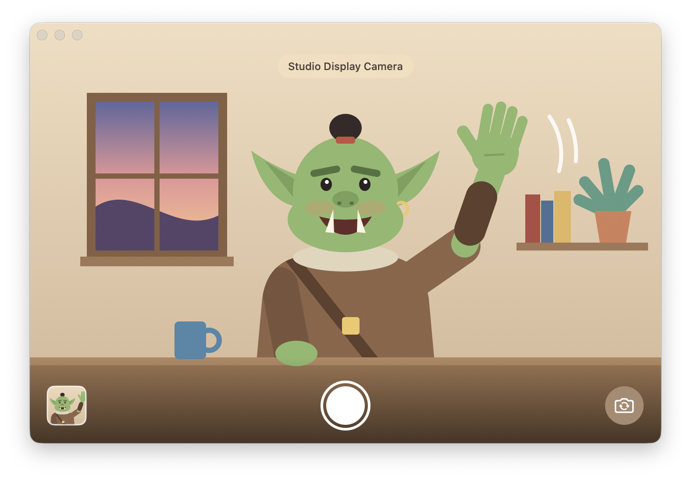

# Camera

A tiny macOS app that does one thing: open it from Spotlight, see yourself,
take a photo or switch cameras, and close it. Like Raycast's "Show Camera",
as a standalone app.

<p>
  
  
</p>

## Install

Requires macOS 14+ and the Xcode command line tools.

```sh
make install
```

Then press ⌘Space, type "camera" and hit Return. It installs to
`~/Applications` (change with `INSTALL_DIR`). Set `SIGN_IDENTITY` to your
signing certificate to keep camera access between reinstalls.

## Use

| Action | How |
| --- | --- |
| Take a photo | Space, Return, or the shutter button |
| Switch to the next camera | Tab, or click the switch button |
| Pick a camera | Hold the switch button, the Camera menu, or ⌘1–⌘9 |
| See your last photo | Click the thumbnail (reveals it in Finder) |
| Close | Esc or ⌘W |

Photos are saved to `~/Pictures/Camera`. Built-in, external, iPhone and Desk
View cameras all work, and the app reopens the one you used last. The camera
turns off when you close or hide the app.

## Develop

```sh
make test         # unit tests
make run          # build and open build/Camera.app
make screenshots  # retake the images above
```

## License

MIT — see [LICENSE](LICENSE).
